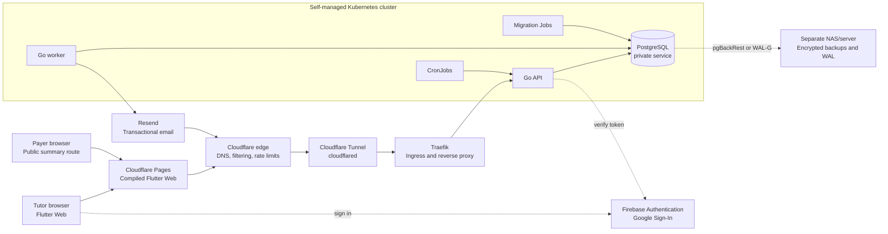

# Penny Technical Architecture Baseline

**Status:** Approved baseline for Pilot planning  
**Version:** 1.0  
**Decision cut-off:** 3 August 2026  
**Audience:** Penny builders, reviewers, and coding agents  
**Source:** Consolidated from the Penny Architecture Decision Record conversation

> This document is the current technical source of truth. A decision marked **Confirmed** may be implemented. An item marked **Open** must be resolved before the affected work begins. Where an older decision conflicts with a newer one, the **Superseded decisions** section records which decision wins.

## 1. How to read this baseline

| Marker | Meaning |
|---|---|
| **Confirmed** | Agreed and part of the baseline. |
| **Open** | Deliberately undecided; do not silently choose a default. |
| **High impact** | Changing this later is possible, but likely to require coordinated code, data, security, API, or deployment migration. |
| **Breaking** | A change can make a deployed client, stored record, public link, integration, or release process stop working unless it is migrated. |
| **Superseded** | An earlier choice that no longer governs implementation. |

“Pilot” means the first real deployment for a small group of tutors. “Workspace” is Penny’s ownership boundary: a tutor’s students, lessons, invoices, payments, and settings belong to that workspace.

## 2. Executive baseline

**Confirmed.** Penny is a deliberately small distributed system:

- Flutter is the single frontend technology. It launches as Flutter Web and is intended to support iOS and Android later.
- Cloudflare Pages hosts the compiled Flutter Web application, including authenticated tutor routes and public payment-summary routes.
- A Go feature-based modular monolith provides a versioned REST/JSON API. A separate Go worker executable reuses the same business modules.
- Kubernetes hosts the Go API, Go worker, database migration Jobs, scheduled CronJobs, and a single PostgreSQL instance.
- External backend traffic passes through Cloudflare Tunnel (`cloudflared`) and Traefik. PostgreSQL remains private inside the cluster.
- Firebase Authentication provides Google Sign-In and identity verification. PostgreSQL remains the only database for Penny business data and authorisation.
- PostgreSQL is the source of truth for lessons, billing, invoices, payments, jobs, and audit history.
- The frontend and backend live in separate repositories and coordinate through a backend-owned, versioned OpenAPI contract.
- Releases are built once, tested in Staging, and promoted to Pilot without rebuilding.

> [!IMPORTANT]
> The hosting split creates two public origins: the Cloudflare Pages frontend and the Kubernetes API. The Go API must use a strict CORS allowlist for approved Local, Staging, Pilot, and explicitly authorised preview origins. Preview deployments must not receive Pilot credentials by default.

## 3. System context and hosting



### 3.1 Component placement

| Component | Placement | Status | Notes |
|---|---|---|---|
| Flutter Web | Cloudflare Pages | **Confirmed · High impact** | Static compiled assets; no frontend pod or NGINX container. |
| Public payment-summary UI | Same Flutter Web application | **Confirmed · High impact** | Public route, no login, only public-safe data. |
| Go API | Kubernetes | **Confirmed · High impact** | Only HTTP service exposed through Traefik. |
| Go worker | Kubernetes | **Confirmed** | Separate executable/deployment; shares backend modules. |
| PostgreSQL | Kubernetes, private | **Confirmed · High impact** | One Pilot instance with persistent storage. Exact deployment mechanism is open. |
| Schema migrations | Kubernetes Job | **Confirmed** | Runs once before new API and worker versions. |
| Periodic scans | Kubernetes CronJobs | **Confirmed** | Triggers work; PostgreSQL stores durable job state. |
| External backend routing | Cloudflare Tunnel → Traefik | **Confirmed · High impact** | Do not expose PostgreSQL publicly. |
| Transactional email | Resend | **Confirmed** | Behind a small Go provider interface. |
| Backup destination | Separate NAS/server | **Confirmed · High impact** | Must survive total cluster loss. |

### 3.2 Domain and route shape

Illustrative names must be replaced with the real domains before deployment:

```text
app.penny.example          → Cloudflare Pages → Flutter Web
api.penny.example          → Cloudflare → Tunnel → Traefik → Go API
staging.penny.example      → Staging Pages deployment
api-staging.penny.example  → Staging Tunnel/Traefik route → Go API
```

Cloudflare Pages must support single-page-app fallback so a direct request such as `/public/summary/<token>` loads `index.html` and is interpreted by `go_router`.

## 4. Architecture principles

**Confirmed.** These rules guide implementation when a lower-level choice is not specified:

1. Prefer a maintainable modular monolith over microservices for the Pilot.
2. Keep PostgreSQL as the authoritative business-data store.
3. Preserve financial history; do not recalculate an old invoice from mutable current settings.
4. Make retries safe through idempotency, constraints, and an outbox—not by assuming exactly-once delivery.
5. Use database transactions for business actions that must succeed or fail together.
6. Keep the frontend and backend independently deployable but contract-compatible.
7. Build the same artifact once and promote it between environments.
8. Treat security as layered: Cloudflare reduces unwanted traffic; Go still authenticates, authorises, validates, and rate-limits.
9. Keep the Pilot changeable. Introduce operators, RLS, managed services, or more observability only when their operational value is clear.

## 5. Source repositories and API coordination

### 5.1 Repository model

**Confirmed · High impact.** Penny uses separate repositories:

```text
penny-frontend/   Flutter Web, future iOS/Android, DESIGN.md, generated Dart client
penny-backend/    Go API and worker, openapi.yaml, migrations, SQL, Kubernetes config
```

Cross-repository work follows a **backend-contract-first** sequence:

1. The backend pull request updates `openapi.yaml` and adds backward-compatible support.
2. Backend CI validates the specification and compares it with the latest released contract.
3. The backend publishes a tagged contract release.
4. The frontend pins that exact release.
5. The Dart client and models are regenerated.
6. The frontend feature is implemented and deployed.
7. Older supported clients continue to work during the migration window.

> [!WARNING]
> A feature is not safely releasable merely because both pull requests exist. The backend-compatible contract must be available before a frontend that depends on it is promoted.

### 5.2 OpenAPI ownership and generation

**Confirmed · Breaking boundary.** The backend repository owns the authoritative `openapi.yaml` under `/api/v1`.

- The contract defines routes, JSON request and response shapes, validation, authentication requirements, and expected errors.
- It generates the Flutter API client and transport models.
- It generates Go transport types and handler scaffolding.
- Generated output is committed in each repository, clearly marked, and never edited manually.
- Generator versions and generation commands are pinned.
- Business logic never lives in generated code.
- CI regenerates code and fails if committed output differs.
- Backend CI blocks accidental breaking changes to the latest `/api/v1` contract.

### 5.3 Contract compatibility and versions

**Confirmed · Breaking boundary.** Backward compatibility is preserved within `/api/v1`.

- Do not remove or rename existing fields or endpoints.
- Do not silently change a field’s meaning, type, format, or authentication requirement.
- New request fields are optional unless a versioned migration says otherwise.
- New response fields are allowed; clients must tolerate unknown fields.
- Enum additions require explicit old-client handling.
- Deprecated fields remain until supported clients migrate.
- A deliberate breaking change requires a planned compatibility period or `/api/v2`.

Tagged contracts use Semantic Versioning:

```text
api-contract-v1.4.2
```

- **Major:** breaking contract change.
- **Minor:** backward-compatible endpoint, field, or capability.
- **Patch:** non-breaking correction or clarification.

The `/api/v1` path names the HTTP API generation; the tag identifies the exact contract revision.

Frontend, backend, and contract versions are independent, with a shared human-readable Pilot label:

```text
Frontend:         v0.8.0
Backend:          v0.12.3
API contract:     v1.4.2
Product milestone: Pilot 3
```

Each deployment records component version, product milestone, commit SHA, artifact digest, and compatible contract version or range.

## 6. Frontend architecture

### 6.1 Flutter scope

**Confirmed · High impact.** Flutter is the consistent presentation layer for:

- authenticated tutor screens;
- the public payer summary;
- Flutter Web now; and
- future iOS and Android applications.

`DESIGN.md` is the visual authority. The public summary uses the same design system but a separate lightweight application path: it must not initialise authenticated tutor state, expose private data, require login, or load unnecessary features.

### 6.2 Navigation and state

**Confirmed.** Penny uses:

- `go_router` for browser URLs, redirects, nested navigation, `/public/summary/:token`, web back/forward behaviour, and future app/universal links;
- Riverpod for state management and dependency injection;
- repositories between Riverpod providers and the generated API client; and
- provider overrides for tests and local mocks.

Widgets do not call the REST API directly. Request/response transport types remain separate from richer domain or view models where that separation is useful.

### 6.3 Public route requirements

**Confirmed · Security-sensitive.** The public summary:

- receives a high-entropy access token in the URL;
- calls only the public-summary API;
- shows only an approved immutable invoice snapshot;
- excludes private notes, internal metadata, and tutor-only navigation;
- provides a generic unavailable state for invalid, revoked, or inaccessible links;
- remains lightweight for in-app browsers and weak connections; and
- supports practical printing or PDF download.

## 7. Backend and API architecture

### 7.1 Go application shape

**Confirmed.** The backend is a feature-based modular monolith with separate API and worker entry points:

```text
cmd/
  api/
  worker/

internal/
  auth/  users/  students/  lessons/  billing/
  invoices/  payments/  notifications/  publicsummary/  jobs/

internal/platform/
  database/  logging/  email/  pdf/  firebase/
```

Each feature owns its handlers, application services, domain rules, repository code, transport mapping, and tests. The API and worker share business modules, not copied implementations.

### 7.2 REST conventions

**Confirmed · Breaking boundary.** Flutter communicates with Go through JSON REST endpoints under `/api/v1`. Public endpoints remain clearly separated, for example:

```text
GET /api/v1/public/summaries/{token}
```

Errors use RFC 9457 Problem Details plus:

- stable Penny `code` values for client behaviour;
- field-level `errors` for validation; and
- a request ID for unexpected failures, without stack traces.

Expected authentication, authorisation, validation, conflict, rate-limit, and service-unavailable responses are documented in OpenAPI.

### 7.3 Pagination, concurrency, and duplicate prevention

**Confirmed.** Penny uses:

- cursor-based pagination for growing lists such as lessons, invoices, payments, jobs, and audit events;
- deterministic ordering and opaque cursors;
- documented default and maximum page sizes;
- optimistic concurrency control for mutable records, normally using a `version` field; and
- `409 VERSION_CONFLICT` when a stale client attempts to update a record.

**Confirmed · High impact.** Consequential writes use an `Idempotency-Key`, including invoice finalisation, payment recording or reversal, email sending, reminder preparation/sending, and public-link rotation. Go retains enough request identity, status, and response data for a limited period to return the original result on a safe retry. Database constraints remain the final duplicate-prevention layer.

## 8. Identity, authorisation, and security

### 8.1 Authentication

**Confirmed · High impact.** Pilot authentication is Firebase Authentication with Google Sign-In only. This supersedes the earlier email magic-link choice.

```text
Flutter → Google Sign-In through Firebase → Firebase ID token
Flutter → Authorization: Bearer <token> → Go API
Go → verify token → read Firebase UID → load Penny membership from PostgreSQL
```

Firebase proves identity. PostgreSQL decides which Penny workspace and data the identity may access. Firestore is not part of the architecture.

### 8.2 Ownership and isolation

**Confirmed · High impact.** Penny uses `users`, `workspaces`, and `workspace_memberships`.

- A Pilot tutor normally has one owner membership in one workspace.
- Students, lessons, invoices, payments, settings, jobs, and audit records are workspace-owned.
- Every authenticated request is authorised against PostgreSQL membership data.
- Every workspace-owned query requires `workspace_id`; UUID knowledge never grants access.
- Repository APIs require workspace context rather than accepting it optionally.
- Constraints include workspace boundaries where appropriate.
- Automated tests attempt cross-workspace reads and writes.

**Confirmed · High impact.** PostgreSQL Row-Level Security is not enabled initially. Isolation is enforced in Go while schema and repository design remain compatible with adding RLS later.

### 8.3 Edge and application protection

**Confirmed.** Cloudflare provides broad filtering, bot protection, and coarse rate limits. Go independently applies endpoint-specific validation and rate limits, especially to:

- public summary lookups;
- authenticated API traffic;
- invoice and reminder sending;
- PDF generation; and
- Resend webhooks.

Rate-limit responses use `429 RATE_LIMITED` and `Retry-After` when useful.

Secrets never appear in Git, frontend builds, container images, logs, analytics, or audit metadata. Local, Staging, and Pilot use separate credentials. Kubernetes service accounts and RBAC restrict access. Rotation procedures are required for Firebase, Resend, PostgreSQL, tunnel, and backup credentials.

## 9. Data and persistence

### 9.1 PostgreSQL access and migrations

**Confirmed.** Go uses `sqlc` with `pgx`:

- SQL is the query source of truth;
- generated `sqlc` code is not edited;
- transactions begin at the application-service boundary when one business action changes multiple records; and
- integration tests run against PostgreSQL, not only mocks.

**Confirmed · Breaking boundary.** Database migrations are SQL-first, ordered, reviewed, and immutable once applied. Seed data is separate. Migrations never run automatically when each API or worker process starts.

Schema changes use **expand and contract**:

1. Add a backward-compatible schema shape.
2. Deploy code that can work with old and new shapes.
3. Migrate or backfill data.
4. Move all clients and workers to the new shape.
5. Remove the old shape only after the rollback window closes.

### 9.2 Foundational representations

The following are **Confirmed · High impact** because changing them after Pilot data exists requires broad schema, API, generated-client, and test migrations:

| Concern | Baseline |
|---|---|
| Entity identifiers | UUIDv7 in PostgreSQL `uuid`; opaque strings in Flutter. External provider IDs use separate columns. |
| Money | Integer minor units plus ISO 4217 currency, e.g. `7550` + `SGD`; PostgreSQL `bigint`, Go `int64`, Dart `int`; never floating point. |
| Precise time | UTC timestamps. |
| Workspace time | Separate IANA time zone, normally `Asia/Singapore` for the Pilot. |
| Calendar concepts | Invoice issue/due dates are dates; recurring schedules use local time plus workspace zone; lesson starts/ends are precise instants. |
| Ownership | Workspace-and-membership model. |

Currency metadata determines minor-unit precision; code must not permanently assume every currency has two decimal places. The Flutter device’s time zone is never the billing source of truth.

### 9.3 Financial and historical invariants

**Confirmed · Breaking boundary.** Finalised financial history is preserved.

- A finalised invoice stores an immutable payer-facing snapshot of approved lesson lines, totals, currency, due date, payment instructions, display details, number, issue date, locale/formatting rules, and PDF template version.
- Finalised invoices cannot be deleted or casually edited.
- Recorded payments cannot be deleted; mistakes use reversal or correction records.
- Cancellation, correction, or replacement does not reuse an issued invoice number.
- Students and recurring schedules may be archived.
- Unused drafts may be deleted only when no dependent records exist.
- Audit events are append-only and contain limited, non-secret context.
- Future workspace deletion requires a separate personal-data deletion or anonymisation design.

Invoice numbers are assigned atomically only on finalisation, using a yearly, workspace-scoped sequence such as `2026-0001`. The UUIDv7 remains the internal primary identifier. Uniqueness is enforced across `(workspace_id, invoice_year, invoice_sequence)`.

### 9.4 Public summary tokens

**Confirmed · Security-sensitive.** A public link remains valid while its invoice is accessible, unless explicitly revoked or rotated.

- Generate a long cryptographically secure random token.
- Store only its hash in PostgreSQL.
- Never use the invoice UUID as the credential.
- Rotation immediately invalidates the old link.
- Do not record tokens in logs, analytics, error reporting, or audit metadata.
- Return the same generic unavailable response for invalid, revoked, and inaccessible tokens.

## 10. Background work and external side effects

### 10.1 Durable jobs

**Confirmed.** Penny uses a PostgreSQL-backed job queue and a separate Go worker. Kubernetes CronJobs initiate periodic scans for monthly billing review, overdue reminder preparation, and cleanup. CronJobs do not become the durable source of job state.

Jobs use:

- exponential backoff with jitter;
- job-specific maximum attempts;
- classification of transient versus permanent failures;
- recorded attempts and failure categories;
- a visible dead-letter state; and
- safe manual retry after the cause is fixed.

Workers must assume at-least-once processing and make handlers idempotent.

### 10.2 Transactional outbox

**Confirmed · High impact.** Business state and its outbox event are written in the same PostgreSQL transaction. External network calls never occur inside that transaction.

```text
Finalise invoice transaction
├── assign invoice number
├── write immutable snapshot
├── append audit event
└── insert outbox event

After commit
└── worker claims event → performs side effect → marks processed
```

Outbox events are append-only, safely claimable by multiple future workers, and retained for a defined troubleshooting window before cleanup.

### 10.3 Email and reminders

**Confirmed.** Resend sends transactional payment-summary and reminder emails through a small Go abstraction. Resend is not used for sign-in after the Firebase decision.

For the Pilot, Penny may automatically identify and prepare an overdue reminder, but the tutor approves it before sending. PostgreSQL—not Resend—decides whether the invoice is due, unpaid, and still eligible.

Resend webhooks follow this path:

```text
Resend → Cloudflare → Tunnel → Traefik → Go webhook endpoint
```

Go verifies the official signature and timestamp against the raw body before processing. Valid events are acknowledged quickly, deduplicated by provider event ID, stored as a minimal durable record, and handed to background processing when needed. Raw payloads are not stored by default.

## 11. PDF and document generation

**Confirmed · High impact.** Go generates the official PDF from the approved immutable invoice snapshot. Flutter owns the interactive preview, but neither frontend state nor current student settings define the historical document.

- PDFs are generated on demand during the Pilot; persistent file/object storage is not initially required.
- The snapshot retains everything needed to reproduce the invoice.
- A PDF template version is stored with the invoice.
- A changed design creates a new template version rather than silently changing old output.
- Private notes and internal metadata are excluded.
- Output should be deterministic for the same snapshot and template version.

## 12. Environments, delivery, and rollback

### 12.1 Environments

**Confirmed.** Penny has three environments:

| Environment | Purpose |
|---|---|
| Local | Developer machines, local PostgreSQL, mocks or test integrations. |
| Staging | Kubernetes deployment with fake data, test email, migrations, and end-to-end checks; resembles Pilot. |
| Pilot | Real tutors and real lesson, invoice, public-summary, and payment records. |

### 12.2 Immutable promotion

**Confirmed · High impact.** CI builds deployable artifacts once, tests them in Staging, and promotes those exact artifacts to Pilot without rebuilding.

- GitHub Actions is the agreed CI/CD system.
- Backend and worker containers are published to a container registry before deployment.
- Backend and worker images are pinned by immutable digest.
- The Cloudflare Pages frontend is promoted as the exact tested static build output, identified by commit and build artifact—not rebuilt from a branch for Pilot.
- Environment configuration and secrets may differ; application binaries/assets do not.
- Every release records its previous known-good artifacts.

### 12.3 Deployment sequence

**Confirmed.** The backend release flow is:

1. Select the tested immutable artifacts.
2. Run the dedicated Kubernetes migration Job once.
3. Stop if the migration fails.
4. Roll out the new API and worker versions.
5. Run probes and automated smoke tests.
6. Complete or reject Pilot promotion.

The API and worker use Kubernetes rolling updates. API readiness prevents traffic before the pod is ready, and `maxUnavailable` should normally be `0`. Worker shutdown stops claiming new jobs and finishes or safely releases active work.

The Cloudflare Pages frontend uses the host’s immutable deployment and rollback mechanism; it is not part of the Kubernetes rolling update.

### 12.4 Health verification

**Confirmed.** Deployments use Kubernetes readiness/liveness checks plus post-deployment smoke tests covering:

- the Cloudflare Pages application and a direct SPA route;
- the Go health endpoint through Cloudflare Tunnel and Traefik;
- PostgreSQL connectivity;
- Firebase-authenticated Staging traffic;
- a public payment summary;
- a test worker job; and
- deployed versions/digests matching the intended release.

A failed smoke test stops promotion or marks the release unsuccessful.

### 12.5 Rollback

**Confirmed · Breaking boundary.** Application artifacts roll back by default; database changes do not automatically roll back.

- Redeploy the previous known-good Pages build, API image, and worker image where compatible.
- Do not run automatic down-migrations against Pilot data.
- Use a reviewed corrective migration when needed.
- Reserve point-in-time recovery for serious data incidents.
- Record rollback decisions and actions.

This policy depends on expand-and-contract migrations. A migration that prevents the previous application version from running removes the normal rollback path and is therefore a high-impact exception requiring explicit review.

## 13. Operations, logging, and recovery

### 13.1 Logging and observability

**Confirmed.** API and worker emit structured JSON logs into the cluster’s existing logging system.

- Include request, job, invoice, and delivery identifiers where relevant.
- Distinguish expected validation failures from application failures.
- Make dead-letter jobs, worker retries, webhook failures, and backup failures visible.
- Redact ID tokens, public tokens, secrets, private notes, unnecessary emails, and payment details.
- Keep log fields consistent across Local, Staging, and Pilot.

The application should remain ready for Sentry or a fuller metrics/tracing stack later, but neither is required for the initial baseline.

### 13.2 Database recovery

**Confirmed · High impact.** The Pilot runs one PostgreSQL instance with persistent storage. Some downtime during node or database failure is accepted; recoverability is more important than premature high availability.

- Use pgBackRest or WAL-G-class tooling.
- Archive backups and WAL to a separate NAS/server outside the cluster.
- Target no more than approximately one hour of data loss after a serious failure.
- Keep 30 days of normal recovery points.
- Provisionally keep one monthly backup for 12 months.
- Support point-in-time recovery.
- Test restoration at least monthly during the Pilot.
- Document the recovery owner, steps, credentials, and evidence of the last successful test.

Backups stored only on the same cluster do not satisfy this baseline.

## 14. Open questions and decision gates

These are deliberately **Open**. The named work must not proceed on an undocumented assumption.

| ID | Open question | Must be resolved before | Minimum acceptance criteria | Impact if delayed or changed |
|---|---|---|---|---|
| OQ-01 | PostgreSQL deployment mechanism: plain StatefulSet, PostgreSQL operator, or existing cluster-standard approach | Infrastructure scaffolding | Persistent volumes, probes, resource limits, controlled upgrades, backup/WAL integration, documented restore | **High: deployment and recovery migration** |
| OQ-02 | Exact backup tool and NAS integration: pgBackRest or WAL-G | Pilot data entry | Encryption, WAL archiving, retention enforcement, alerts, point-in-time restore test | **High: data-loss exposure** |
| OQ-03 | Backup/restore operational owner and evidence process | Pilot launch | Named owner, monthly restore calendar, runbook, recorded result | **High: operational risk** |
| OQ-04 | Exact secrets-management tool reused from the cluster | Staging deployment | No plaintext in Git; environment separation; RBAC; rotation; encryption at rest where available | **High: security and deployment migration** |
| OQ-05 | `cloudflared` placement and Cloudflare-to-Traefik encryption/certificate automation | External Staging access | Documented tunnel ownership, TLS path, private routes, failure handling | **High: routing/security migration** |
| OQ-06 | Final domain names and CORS allowlists, including preview policy | Frontend/API integration | Explicit allowed origins; no wildcard with credentials; preview isolation | **High: frontend/backend and security change** |
| OQ-07 | Exact Go PDF library | PDF implementation | Deterministic output, font support, testability, template versioning | Medium: backend implementation change |
| OQ-08 | Retention periods for outbox, webhook, idempotency, and dead-letter records | Production cleanup jobs | Troubleshooting window, privacy minimisation, safe deletion rules | Medium: data migration |
| OQ-09 | Invoice numbering/legal presentation review for the intended market | Pilot invoice issuance | Confirm required fields, correction treatment, and whether the chosen yearly workspace sequence is acceptable | **High: data, PDF, and product migration** |
| OQ-10 | Future workspace deletion/anonymisation process | Any user deletion promise | Financial-retention rules, personal-data scope, audit treatment, recovery implications | **High: privacy and data migration** |

## 15. Breaking and high-impact decision register

This is the change-warning list requested by the product owner. Before changing one of these items, create a new ADR with a migration plan, compatibility window, rollback path, affected repositories, and test strategy.

| ID | Current decision | A change could force |
|---|---|---|
| HI-01 | Separate frontend/backend repositories with backend-owned OpenAPI | Coordinated repository, CI, contract publication, and deployment workflow changes. |
| HI-02 | Backward-compatible `/api/v1` with generated pinned clients | Frontend/mobile client migration, dual API support, OpenAPI major release, and rollout sequencing. |
| HI-03 | Cloudflare Pages frontend; Kubernetes backend | DNS, CORS, SPA routing, secrets, release promotion, monitoring, and rollback changes. |
| HI-04 | Cloudflare Tunnel plus Traefik | Ingress manifests, DNS/TLS, webhook endpoints, trust boundaries, allowlists, and incident procedures. |
| HI-05 | Firebase Google Sign-In only | Onboarding, token verification, user identity mapping, account linking, recovery, and possibly UID migration. |
| HI-06 | Workspace ownership with application-enforced isolation and no initial RLS | Repository signatures, SQL, session/transaction context, policies, integration tests, and incident review. |
| HI-07 | Single PostgreSQL instance in Kubernetes | Data export/import, connection endpoints, credentials, network paths, backup tooling, downtime, and release procedures when moving to managed PostgreSQL or HA. |
| HI-08 | UUIDv7 identifiers | Every primary/foreign key, API schema, generated client, cursor, fixture, and integration. |
| HI-09 | Integer minor-unit money plus ISO currency | Schema types, calculations, API fields, imports/exports, invoice snapshots, PDFs, and historical data. |
| HI-10 | UTC instants plus workspace IANA time zone and distinct calendar dates | Recurrence rules, lesson times, billing periods, due dates, API types, and historical interpretation. |
| HI-11 | Immutable invoice snapshots and append-only financial/audit history | Correction UX, schema, legal/audit semantics, exports, PDFs, and deletion policy. |
| HI-12 | Yearly workspace-scoped invoice numbers assigned at finalisation | Unique constraints, transaction locking, visible documents, correction flow, and existing issued records. |
| HI-13 | Public summary tokens valid until revocation/rotation | Link lifecycle, payer access, support procedures, token data, public caching, and security expectations. |
| HI-14 | Transactional outbox plus at-least-once jobs | Invoice/email transaction boundaries, job schemas, idempotency, retry behaviour, and operational tooling. |
| HI-15 | Build once and promote immutable artifacts | CI/CD design, environment configuration, provenance, release records, and rollback reliability. |
| HI-16 | Expand-and-contract migrations; no automatic DB rollback | Schema-release ordering, compatibility windows, cleanup timing, recovery procedures, and old-version support. |
| HI-17 | Go-generated on-demand PDFs from versioned snapshots | Backend dependencies, template storage/versioning, object storage, email attachment flow, and historical reproducibility. |
| HI-18 | PostgreSQL-backed queue and Kubernetes CronJobs | Worker code, job state, retries, monitoring, operational dependencies, and data migration if replaced. |

### What counts as a breaking change

Treat a proposal as breaking when it does any of the following:

- makes a deployed frontend or mobile client unable to call the API;
- changes the meaning or representation of stored financial or time data;
- invalidates existing public links, invoice numbers, or generated documents unexpectedly;
- weakens or changes a workspace’s authorisation boundary;
- prevents the previous application artifact from running after a schema migration;
- requires exposing PostgreSQL or moving secrets across a new trust boundary;
- changes whether a side effect can be duplicated or lost; or
- makes an existing backup unusable without a conversion procedure.

## 16. Superseded decisions

These entries are retained so older notes are not mistaken for current guidance.

| Earlier decision | Current decision that replaces it | Implementation rule |
|---|---|---|
| Email magic-link authentication | Firebase Authentication with Google Sign-In only | Do not build magic-link tokens or sessions. Resend is for transactional product email. |
| Monorepo recommendation | Separate frontend and backend repositories | Coordinate through tagged OpenAPI releases and independent CI. |
| Flutter Web container in Kubernetes | Cloudflare Pages for Flutter Web | Do not create a frontend pod or route frontend assets through Traefik. |
| Kubernetes rolling update for Flutter Web | Cloudflare Pages immutable deployment/rollback | Rolling updates apply to API and worker only. |
| Traefik routes Flutter Web | Pages serves Flutter; Traefik routes backend HTTP | Public summary UI is on Pages; its API call enters through Tunnel and Traefik. |
| Go-rendered public summary recommendation | Same Flutter Web app renders the public summary | Keep the public route lightweight and isolated from authenticated state. |
| Ingress controller entirely open | Cloudflare Tunnel plus Traefik confirmed | Only placement, encryption/cert automation, and detailed route ownership remain open. |
| Daily backups alone | WAL-aware backup tool, approximately one-hour RPO, 30-day recovery points plus monthly copies | Daily-only backup is insufficient for the accepted recovery target. |

## 17. Implementation gates

### Before infrastructure scaffolding

- Resolve OQ-01, OQ-02, OQ-04, and OQ-05.
- Record real domain names and the environment CORS matrix.
- Produce and rehearse the initial PostgreSQL restore runbook.
- Confirm the Pages build-once/promotion mechanism.

### Before backend feature development

- Publish the initial `/api/v1` OpenAPI contract and generator versions.
- Establish workspace-required repository interfaces.
- Define UUIDv7, money, date/time, Problem Details, pagination, concurrency, and idempotency conventions.
- Add CI compatibility and generated-code checks.

### Before Pilot data

- Pass cross-workspace authorisation tests.
- Pass a real backup and point-in-time restore test.
- Verify token, webhook, secret, and log redaction rules.
- Verify migration rollback compatibility with the previous known-good application.
- Pass the full smoke suite through Cloudflare Pages, Tunnel, and Traefik.
- Resolve invoice presentation/legal review and operational ownership.

## 18. Decision governance

This baseline may evolve, but changes should be explicit:

1. Add an ADR stating the problem, current rule, options, and chosen change.
2. Mark whether the change touches a high-impact ID in section 15.
3. List affected frontend, backend, data, deployment, security, and API surfaces.
4. Define the compatibility window and data migration/backfill.
5. Define rollback or forward-recovery steps.
6. Update OpenAPI, generated code, migrations, tests, diagrams, and this baseline in the same coordinated change.
7. Do not mark an open question as resolved merely because an implementation selected a default.

---

**Baseline statement:** Penny’s Pilot architecture is Cloudflare Pages for Flutter Web; Cloudflare Tunnel plus Traefik for external backend routing; and Kubernetes for the Go API, Go worker, migration Jobs, CronJobs, and private PostgreSQL. The system uses a backend-owned OpenAPI contract, immutable financial history, safe asynchronous processing, off-cluster recovery, and migration-aware delivery as its core technical guardrails.
